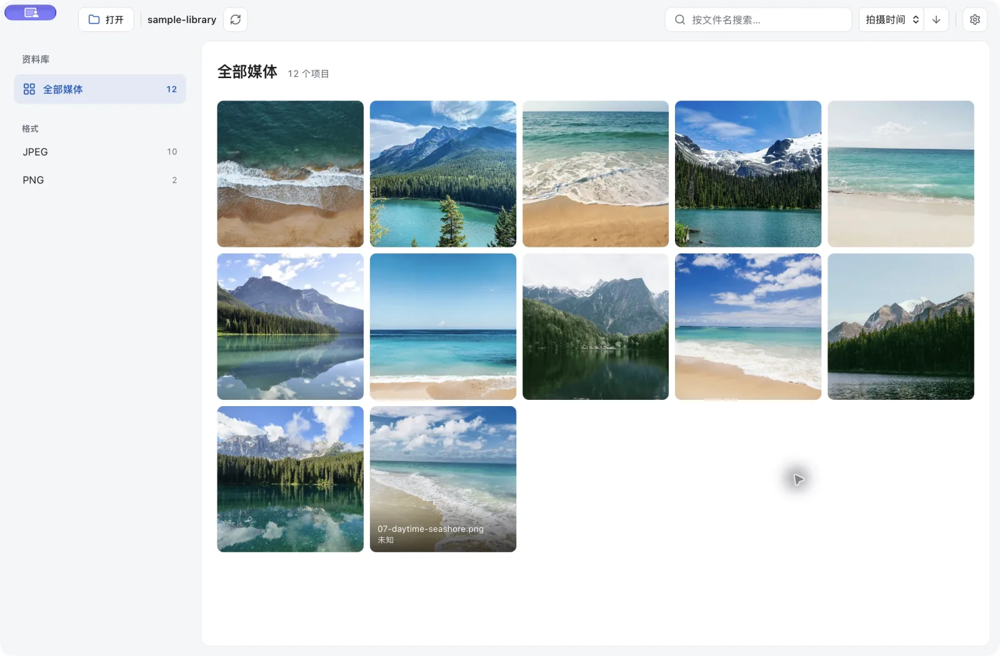

# 照片浏览器 (Photo Browser)

一个本地优先的桌面照片/视频浏览器，基于 **Tauri 2 + React + Rust**。打开本地目录，自动解析元数据、生成缩略图并建立索引，支持多维度检索与丝滑大图预览。文件始终留在本机，不上传任何服务器。

🌐 **官网**：<https://fanhefeng.github.io/photo-browser/> · 📦 **下载**：[最新 Release](https://github.com/fanhefeng/photo-browser/releases/latest)




适用于 **Apple Silicon（M 系列）Mac，macOS 11 及以上**。当前没有 Intel、Windows 或 Linux 安装包；暂不支持 RAW。首次安装的系统放行说明见下文。

## 功能

- **照片 + 视频**：递归扫描，照片识别 JPG/PNG/HEIC/TIFF/WebP 等；视频识别 MP4/MOV/MKV/WebM 等
- **多维度检索**：按类型（照片/视频）、拍摄时间（年）、相机型号、镜头、格式、是否含 GPS 筛选；按文件名搜索
- **分类排序**：按拍摄时间 / 文件名 / 文件大小 / 分辨率 / ISO / 焦距 升降序排列
- **完整元数据详情**：相机、镜头、光圈、快门、ISO、焦距、尺寸、拍摄时间、视频时长、GPS（可一键跳转地图）
- **看图增强**：照片大图支持滚轮缩放（以光标为锚）、双击放大、拖拽平移、缩放工具条（百分比以原始像素为基准，含 1:1 实际像素按钮，最高 8× 适应尺寸）；放大按目标尺寸从原图重新采样，清晰度与系统「预览」一致；视频可播放并拖动进度
- **浏览性能**：虚拟滚动网格（减少大图库的页面渲染开销；实际速度取决于设备、文件格式和存储介质）+ 自定义协议缩略图 + 高清预览懒加载与相邻预热
- **增量扫描**：再次打开同一目录只处理新增/改动的文件；扫描可取消，拒绝并发
- **系统"打开方式"查看器**：可在访达中用本应用打开图片/视频，弹出独立的简洁查看器窗口——同目录文件左右切换（按钮或 ←/→）、滚轮缩放、1:1 实际像素、`i` 信息面板、`⌫` 移入废纸篓、Esc 关闭。设为默认：文件「显示简介 → 打开方式」选择本应用并点「全部更改」
- **设置与换肤**：工具栏齿轮或菜单「设置…」（⌘,）打开——三套主题皮肤（经典浅色 / 奶油贴纸 / 石墨深色，奶油贴纸取自 app 图标配色）、缩略图大小、悬停信息开关、语言、启动自动检查更新；全部即时生效并记忆

## 安装（macOS）

1. 在 [Releases](https://github.com/fanhefeng/photo-browser/releases/latest) 下载 `.dmg`，打开后把「照片浏览器」拖入「应用程序」。
2. 本应用**尚未完成 Apple Developer ID 签名与公证**，首次打开可能被 Gatekeeper 拦截或提示“已损坏”。这条提示不能单独证明文件安全，也不能排除下载损坏。请只从上方官方 GitHub Release 下载；如果系统提供“系统设置 → 隐私与安全性 → 仍要打开”，请先确认来源再按系统提示操作。

   若系统仍拒绝打开，优先重新下载并核对 Release 提供的 SHA-256。只有在确认来源与完整性、理解绕过隔离检查的风险后，才考虑针对本应用清除下载隔离属性：

   ```bash
   xattr -dr com.apple.quarantine /Applications/photo-browser.app
   ```

   此命令会移除该应用的下载隔离标记，不是安全验证或损坏修复工具；不要对未知来源的软件使用。不同 macOS 版本和管理策略下的行为可能不同。

3. v0.4.4 起支持应用内更新（可在设置中关闭启动检查，或通过菜单手动检查）。更新包经过 minisign 签名校验，但该签名不等同于 Apple 公证，也不保证所有系统都不再出现安全提示。

系统要求：Apple Silicon（M 系列）Mac，macOS 11 Big Sur 及以上。

## 依赖

- **视频功能依赖 `ffmpeg` / `ffprobe`**（封面抽帧 + 元数据）。Release 版 dmg 已内置，无需安装；从源码运行（`pnpm tauri dev`）时需自行安装：`brew install ffmpeg`。未安装时照片功能不受影响，应用会顶部提示
- HEIC/HEIF/AVIF 依赖 macOS 自带 `sips`

## 架构

```
前端 (React + Vite，WebView)
  · 目录选择 · 虚拟滚动网格 · 分面筛选 · 大图查看
        │  Tauri IPC + 自定义图片协议 (thumb:// / preview://)
Rust 后端 (src-tauri)
  · walkdir 扫描   · kamadak-exif 解析   · image/sips 缩略图
  · rayon 并行     · rusqlite 索引 (SQLite, WAL)
        │
缓存根目录（随环境/系统而定，见下文「运行环境与目录」）
  ├── index.db      索引数据库
  ├── thumbs/       640px 缩略图（扫描时生成）
  ├── previews/     高分辨率预览（HEIC/TIFF 等懒生成，最长边 3840px）
  └── logs/         运行日志（按天滚动）
```

**关键设计**：扫描一次把元数据写入 SQLite，之后所有筛选/排序都是数据库查询；缩略图通过自定义 URI 协议由 WebView 原生加载，而非 IPC 传 base64——这是性能丝滑的基础。

## 运行环境与目录

派生数据按**用途**分三类目录（遵循各平台规范），并按**环境**（dev/prod）与**系统**隔离，互不污染。

- **环境判定**：`tauri dev`（debug 构建）= **dev**，目录名 `com.fhf.photo-browser-dev`；`tauri build`（release 构建）= **prod**，目录名 `com.fhf.photo-browser`。
- **为什么分三类**：缓存目录会被系统清理（磁盘紧张/优化存储/清理工具）→ 只放可再生的缩略图/预览图；索引库与日志不应被清理 → 放数据目录与日志目录。
- **缓存被清掉之后**：索引还在、缩略图没了。增量扫描因此**不只比 mtime**，还会检查缩略图是否仍在缓存里（见 `scan.rs` 的 `needs_processing`）——否则每个文件都会被判定"未改动"而跳过，网格从此全是破图且重扫也修不好。

### 开发环境 (dev) — `tauri dev`

| 类别 | macOS | Linux | Windows |
|------|-------|-------|---------|
| 数据 `index.db` | `~/Library/Application Support/com.fhf.photo-browser-dev/` | `~/.local/share/com.fhf.photo-browser-dev/` | `%LOCALAPPDATA%\com.fhf.photo-browser-dev\` |
| 缓存 `thumbs/` `previews/` | `~/Library/Caches/com.fhf.photo-browser-dev/` | `~/.cache/com.fhf.photo-browser-dev/` | `%LOCALAPPDATA%\com.fhf.photo-browser-dev\` |
| 日志 `photo-browser.log.<日期>` | `~/Library/Logs/com.fhf.photo-browser-dev/` | `~/.local/share/com.fhf.photo-browser-dev/logs/` | `%LOCALAPPDATA%\com.fhf.photo-browser-dev\logs\` |

### 生产环境 (prod) — `tauri build`

| 类别 | macOS | Linux | Windows |
|------|-------|-------|---------|
| 数据 `index.db` | `~/Library/Application Support/com.fhf.photo-browser/` | `~/.local/share/com.fhf.photo-browser/` | `%LOCALAPPDATA%\com.fhf.photo-browser\` |
| 缓存 `thumbs/` `previews/` | `~/Library/Caches/com.fhf.photo-browser/` | `~/.cache/com.fhf.photo-browser/` | `%LOCALAPPDATA%\com.fhf.photo-browser\` |
| 日志 `photo-browser.log.<日期>` | `~/Library/Logs/com.fhf.photo-browser/` | `~/.local/share/com.fhf.photo-browser/logs/` | `%LOCALAPPDATA%\com.fhf.photo-browser\logs\` |

### 各文件说明

| 文件 | 说明 |
|------|------|
| `index.db` | SQLite 索引库（WAL 模式，运行时另有 `index.db-wal` / `index.db-shm`） |
| `thumbs/<id>.jpg` | 640px 缩略图，扫描时生成（`<id>` 为文件绝对路径的 blake3 哈希） |
| `previews/<id>.jpg` | 高分辨率预览，仅 HEIC/TIFF 等不可直接显示的格式生成（最长边 3840px；放大超过该分辨率时自动换原图或全分辨率转码） |
| `logs/photo-browser.log.<日期>` | 运行日志，按天滚动、保留最近 14 天；dev 级别 `debug`、prod 级别 `info`，可用 `RUST_LOG` 覆盖 |

### 备注

- JPG/PNG/WebP/GIF 等 WebView 可直接解码的格式，大图**直接读原文件**呈现原始清晰度，不生成预览。
- Windows 上数据与缓存同属 `%LOCALAPPDATA%`，靠不同子目录/文件名区分，不会冲突。
- 路径解析（`dirs` crate）跨平台，但部分功能（HEIC 解码用 `sips`、"在访达中显示"用 `open`）目前面向 macOS；Linux/Windows 下数据会落在上表位置，但相关功能需另行适配。
- 运行时实际路径：启动会打印到 DevTools 控制台（含三类目录），或调用 `app_info` 命令获取。
- **历史遗留**：旧版本曾把所有数据混放在 `~/Library/Caches/com.fhf.photo-browser`（macOS），可安全删除：`rm -rf ~/Library/Caches/com.fhf.photo-browser`。

## 第三方软件

自有代码采用 MIT；打包的 FFmpeg/ffprobe 使用其各自适用许可。来源、对应源码附件及构建说明见 [第三方软件说明](THIRD_PARTY_NOTICES.md)。

## 开发

```bash
pnpm install
pnpm tauri dev      # 开发模式运行
pnpm tauri build    # 打包成 .app / .dmg
```

## 已知限制

- HEIC/HEIF/AVIF 依赖 macOS 自带的 `sips` 解码（本应用为 macOS 设计）
- 暂未做基于画面内容的 AI 检索（人/物/场景）——可作为后续扩展（接入 CLIP 等视觉模型）
